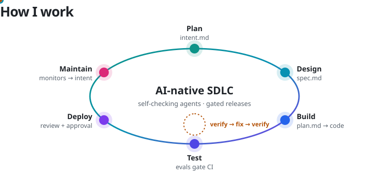
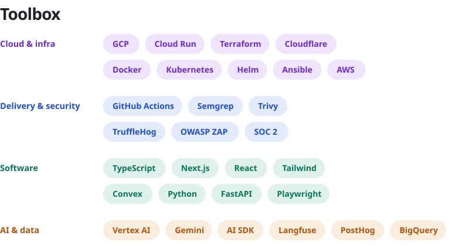

<picture>
  <source media="(prefers-color-scheme: dark)" srcset="assets/hero-dark.svg">
  
</picture>

<picture>
  <source media="(prefers-color-scheme: dark)" srcset="assets/what-i-do-dark.svg">
  
</picture>

<picture>
  <source media="(prefers-color-scheme: dark)" srcset="assets/how-i-work-dark.svg">
  
</picture>

I run delivery as an AI-native SDLC. Every change starts as an intent, becomes a spec and an approved plan, then agents build it and prove it against tests and evals in CI. Hooks and code-owner review gate what reaches production, and monitoring feeds what it finds back in as new intent. My job is the skills, hooks and gates that keep that loop fast and safe.

<picture>
  <source media="(prefers-color-scheme: dark)" srcset="assets/toolbox-dark.svg">
  
</picture>

<picture>
  <source media="(prefers-color-scheme: dark)" srcset="assets/selected-project-dark.svg">
  
</picture>

**[Hashcat-cloud](https://github.com/IbrahimEllouze/Hashcat-cloud)** — an on-prem GPU cloud on Kubernetes for password-recovery workloads, built at Securas Technologies. RTX 3090 nodes, NVIDIA GPU Operator, Calico and Helm; Terraform for cluster resources and Ansible for node setup.

  <a href="mailto:ellouzeibrahim0@gmail.com"><picture><source media="(prefers-color-scheme: dark)" srcset="assets/pill-email-dark.svg"></picture></a>
  <a href="https://www.linkedin.com/in/ibrahim-ellouze"><picture><source media="(prefers-color-scheme: dark)" srcset="assets/pill-linkedin-dark.svg"></picture></a>
  <a href="https://ibrahim-ellouze.netlify.app/"><picture><source media="(prefers-color-scheme: dark)" srcset="assets/pill-portfolio-dark.svg"></picture></a>

 

<picture>
  <source media="(prefers-color-scheme: dark)" srcset="assets/footer-dark.svg">
  
</picture>
